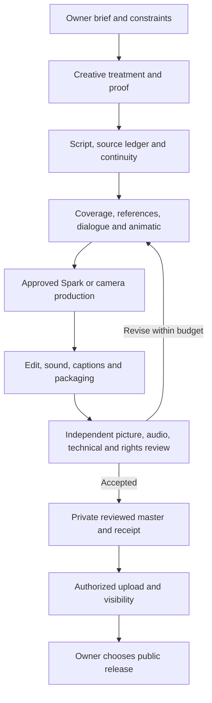

# Labverse Media Studio

Codex crew instructions, production contracts and Python media tools for planning and producing original video, documentary films, Shorts, audio and episodic work with DGX Spark.

**This is a reviewed source snapshot, not a turnkey autonomous production service.** The crew package and documentary tools exist. Google Drive intake, unattended coordination and YouTube API delivery are design documents awaiting implementation and account qualification. Public release remains a separate owner decision.

## Start here

1. Read the [complete production workflow](docs/PRODUCTION-WORKFLOW.md), [capability review](docs/REPOSITORY-REVIEW.md) and [artifact contracts](docs/ARTIFACTS.md).
2. Run the safe local checks with Python 3.12:

   ```sh
   python scripts/validate_studio.py
   python scripts/validate_repository.py
   python -m pip install -r requirements-test.txt
   python -m unittest discover -s runtime/documentary_engine/tools -p test_comfy_pipeline.py
   python -m unittest discover -s runtime/documentary_engine/tests -p test_render_short.py
   ```

   The first two checks use only the standard library. The adapter tests need the lightweight test dependencies listed above. These checks do not contact Spark, download models or publish media.
3. Open the checkout as a Codex project and review [AGENTS.md](AGENTS.md). The 13 [crew definitions](docs/CREW-AND-SKILLS.md) and nine project skills provide role instructions. Discovery and actual delegation depend on your installed client and project trust; file validation alone does not prove they load.
4. Use the fictional [Meter Room example](examples/meter-room/BRIEF.md) for a planning rehearsal. Create real production records under `productions/<slug>` and keep source media in approved private storage.
5. For rendering, follow the [runtime setup](runtime/documentary_engine/README.md) and [Spark runbook](docs/SPARK-RUNBOOK.md). Use only reviewed inputs and operator-approved resources.

## What is included

| Area | Contents |
| --- | --- |
| `.codex/agents/` | Producer, creative lead, showrunner, writer, director, cinematographer, art director, Spark operator, sound, editor, rights, QC and channel producer |
| `.agents/skills/` | Production, creative development, screenwriting, cinematography, rendering, sound/captions, post-production, rights/release and clip production |
| `examples/` and `templates/` | Fictional scene, shot/asset/dialogue CSVs and gate record |
| `runtime/documentary_engine/` | Narration, imagery, media sourcing, music/score, motion, HUD, captions, thumbnails, metadata, composition, ComfyUI and Shorts adapters, selected tests |
| `docs/drive-automation-v1/` | Nine-document plan for Drive intake, Spark coordination, review, recovery and Unlisted delivery |
| `docs/SOURCE-MANIFEST.json` | Source snapshot identities and file hashes |

## Workflow



The [Drive-to-Unlisted plan](docs/drive-automation-v1/README.md) describes a future automated route through these stages. Copying these files does not implement its connectors, authentication, startup, fault recovery or review tools.

## Publication boundaries

No credentials, OAuth tokens, private host configuration, original Git history, model weights, production media, voice references, consent records, episode deliveries or service-control demonstration scripts are included. Supplied third-party workflow graphs are excluded pending redistribution review. Provide your own qualified graph to the adapters.

This repository grants no rights to external models, music, voices, footage or third-party software. Their licenses and intended use require separate review. Historical research dates and benchmarks are retained as context, not current capacity claims. See [security](SECURITY.md) and [provenance](docs/PROVENANCE.md).
