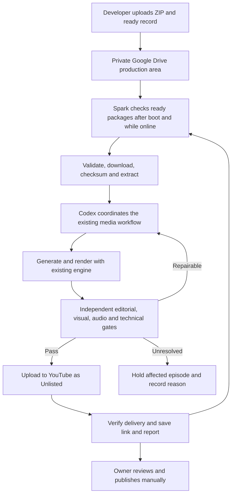

# Documentary automation with Google Drive — version 1

**Date:** 20 November 2026 (Asia/Karachi)
**Status:** Complete planning package; implementation and account qualification pending.
**Selected direction:** Reuse the owner's existing Google Drive subscription, subject to account qualification.
**Execution:** Codex CLI on DGX Spark, using the existing documentary media engine.
**Delivery:** YouTube Unlisted; public publication remains the owner's action.

## Read these documents

| Document | Contents |
| --- | --- |
| [IMPLEMENTATION-PLAN.md](IMPLEMENTATION-PLAN.md) | Full architecture, operating flow, boundaries, implementation work, and acceptance criteria |
| [DRIVE-INTAKE-CONTRACT.md](DRIVE-INTAKE-CONTRACT.md) | Developer submission format, READY record, storage ownership, authorization, download, and duplicate rules |
| [MEDIA-QUALITY-GATES.md](MEDIA-QUALITY-GATES.md) | Existing media production stages, source verification, archival imagery, sound, captions, independent review, and corrections |
| [CLI-MEDIA-WORKFLOW-PARITY.md](CLI-MEDIA-WORKFLOW-PARITY.md) | Actual PC role/skill inventory, deployable runtime package, Pro/cloud versus local Qwen, comparison tests, and complete PC copy-back |
| [SPARK-OPERATIONS-AND-RECOVERY.md](SPARK-OPERATIONS-AND-RECOVERY.md) | Spark installation qualification, startup, checkpoints, interrupted jobs, cache isolation, budgets, and retention |
| [YOUTUBE-UNLISTED-DELIVERY.md](YOUTUBE-UNLISTED-DELIVERY.md) | Channel authorization, fixed upload settings, thumbnails, captions, links, resumable transfers, and delivery evidence |
| [VALIDATION-AND-ROLLOUT.md](VALIDATION-AND-ROLLOUT.md) | Implementation phases, failure tests, live pilot, sustained trial, acceptance, and rollback |
| [RESEARCH-AND-DECISIONS.md](RESEARCH-AND-DECISIONS.md) | Current primary sources, design decisions, unresolved setup facts, and limitations |

These nine Markdown files form one plan, revised to version 1.1 on 20 November 2026. The implementation plan is the main narrative; the companion documents define the contracts needed to implement it. The parity addendum explicitly covers the owner's existing desktop-led flow and local Qwen 27B plus cloud options.

## Intended experience

The developer uploads a completed episode package to the private production area in Drive. When Spark is online, it discovers ready work, validates it, runs the established media production and review stages, uploads accepted results as Unlisted, and writes a delivery report. After a restart, it reconciles saved artifacts and continues from the last verified stage. The owner reviews videos in YouTube Studio and decides when to publish them.

## What changed from the earlier discussion

- Google Drive replaces WhatsApp and the proposed self-hosted workspace as the intake source.
- Spark discovers persistent files rather than depending on message delivery or a public webhook.
- Developer submissions have explicit completion, version, and checksum rules.
- Google One and Workspace ownership are separate setup branches; owning a shared folder does not automatically make another user's uploads consume the owner's allowance.
- Production uses the existing media workflow, with supported API connectors for intake and delivery.
- Public publication is outside the automation's permitted operations.

## What this delivery did

Created and checked the planning documents only. No Drive folder, OAuth application, service, timer, credential, runtime dependency, render, upload, or production configuration was created or changed. Example JSON, paths, states, and policy values in these documents are proposed implementation contracts, not installed capabilities.

The exact Google subscription type, available storage, folder IDs, OAuth grants, and unattended CLI installation on Spark still require live qualification. The user's approval to use Drive is recorded; these setup facts do not require reopening the platform choice.

Routine compliant episodes are intended to run without human prompts after setup. Revoked authorization, an unresolved factual or rights issue, or an ambiguous external write can still require an exception. The plan preserves the work and reports the reason rather than claiming that every failure can be repaired autonomously.
